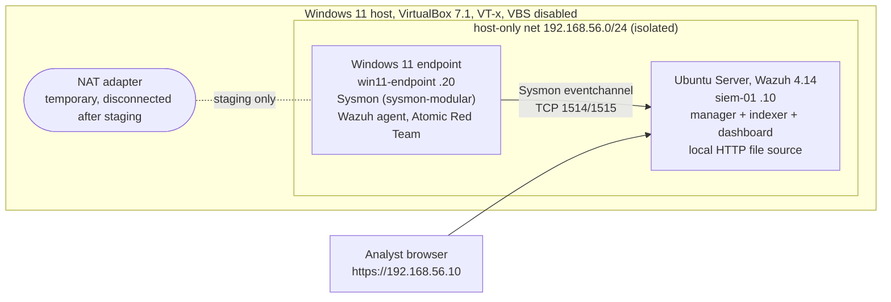
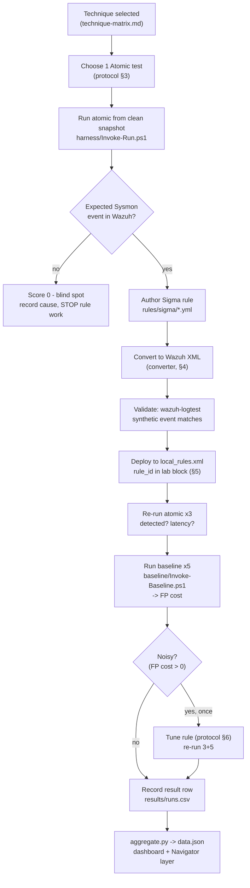

# Design Specification (Milestone 2)

**Project:** Detection-as-Code - Lab for Measuring MITRE ATT&CK Detection Coverage with Sysmon, Sigma, and Atomic Red Team
**Author:** Stephen Laing
**Advisor:** Dr. Sayeed Sajal
**Course:** CS 4200, UVU
**Framework:** MITRE ATT&CK Enterprise **v20** (2026-10-13)

This document is the Milestone 2 design: the architecture, the detection pipeline, and the conventions the measurement phase will follow. It is the bridge between the Milestone 1 build: 2 VM lab with telemetry flowing, and the Milestone 3 measurement: scoring of 15 techniques. Every Milestone 2 file is referenced here.

## 1. Design Goals
1. **Reproducible.** Anyone can rebuild the entire lab and pipeline from this repo.
2. **Measurable.** Each technique will be measure with 2 numbers: 
    1. *Coverage score (0-3)*
    2. *False-positive cost*\
    These will be defined once (`evaluation-protocol.md`) and computed from raw run records, never asserted.
3. **Detection-as-Code.** Detections live as version-controlled text (Sigma as source of truth, Wazuh XML as a build artifact), validated before deployment, not clicked into a GUI.
4. **Documentation of Limits.** Blind spots, atomic-test failures, converter fidelity gaps, and Defender interference are recorded as results.

## 2. System Architecture (Built in Milestone 1)



- The endpoint is **isolated** on the host-only network during all measurements. The NAT adapter exists only to stage the prerequisites and Atomic Red Team, then disconnected and the VM is snapshotted again (`ep-02-baseline`).
- The SIEM VM doubles as the **local file source** for any technique or baseline action that needs a network download (T1105), so no test ever reaches the internet at run time.
- Host hardening done in M1 (VBS/hypervisor off via Microsoft SecConfig) is a **prerequisite** since without it, VirtualBox fell back to native-API mode and the guest hit RCU stalls that would corrupt every time-to-alert measurement.

## 3. Detection-as-Code Pipeline



**Telemetry is confirmed before any rule is written.** A score of 0 ends the pipeline for that technique with a documented blind spot, so the project doesn't write a rule for an event that was never captured.

## 4. Sigma -> Wazuh Conversion

Sigma is the source of truth. Converted Wazuh XML is a build artifact validated per rule. If conversion is lossy or unavailable, the rule will be authored directly in Wazuh XML and the Sigma file will document the intent.

There is **no official pySigma backend for Wazuh**. Candidate tooling (to trial on the T1059.001 gate rule in Week 4/8 and record the winner in `research-notes.md`): community pySigma Wazuh backends, `sigma_to_wazuh`, `SigWaz`, `sigWah`. Known gaps that must be checked per rule, not assumed:

- `if_sid` scoping (a converted rule must be a child of the correct Sysmon base rule, e.g. `61603` for Event 1)
- Severity/level mapping (Sigma `level` -> Wazuh `level`)
- Unsupported modifiers: `base64offset|contains`, `|near`, aggregation/`timeframe` correlation - these do not translate and are either reworked or noted as a fidelity gap in the rule's ADS
- Field-name mapping (Sigma logsource fields -> Wazuh `win.eventdata.*`)

**Fidelity check (every converted rule):** craft a synthetic event, run `wazuh-logtest`, confirm it matches the intended rule and level. Record the transcript. A rule that cannot be validated this way is not deployed.

## 5. Rule ID Namespace

Wazuh custom rules must be ≥ 100000. The lab reserves blocks so IDs are stable and traceable:

| Range | Purpose |
|---|---|
| 100100-100199 | Scaffolding / verification (e.g. 100100, the M1 Sysmon-Event-1 sanity rule, **removed before baseline runs**) |
| 100200-100499 | Detection rules under test, one block of 10 per technique in matrix order (T1059.001 -> 100200, T1053.005 -> 100210, ...). `design/techniques.yml` holds the assignments. |
| 100900-100999 | Experimental / tuning spares |

Each detection rule carries a `<mitre><id>` tag so Wazuh's own ATT&CK mapping agrees with the matrix.

## 6. Outputs

Two artifacts, both generated from `results/runs.csv`:

1. **HTML Dashboard** (`dashboard/index.html` + `data.js`). An ATT&CK-style board colored by coverage score, summary tiles, and a per-technique metrics table. No server required, it is a plain-language view for a non-technical reader.
2. **ATT&CK Navigator Layer** (`dashboard/navigator-layer.json`, generated in Week 8). The same scores as a Navigator overlay for the security-literate reader. Generation script reads `data.json` and emits a v20-compatible layer, and scores map to Navigator cell scores/colors.

## 7. Repository Layout

```
README.md                                   Overview, Quickstart, Reproduce
docs/
    design-spec.md                          This File
    technique-matrix.mc                     15 techniques, Selection criteria, Tactic spread
    evaluation-protocol.md                  Metrics, Run loop, Baseline, Tuning, Validity
    research-notes.md                       Living file of decisions with sources
    lab-build.md                            M1 Build
    templates/
        ads-template.md                     Per-rule ADS template
        ads-T1059.001-example.md            Worked Example
design/
    techniques.yml                          Machine-readable matrix (source for harness + dashboard)
baseline/
    Invoke-Baseline.ps1                     Scripted benign admin workload + manifest
harness/
    Invoke-Run.ps1                          Atomic run wrapper (timestamps, partial record)
    aggregate.py                            runs.csv -> dashboard/data.json + data.js
    validate.py                             CI checks (schema, matrix, rule-id uniqueness)
rules/
    sigma/                                  .yml file per technique (source of truth)
    wazuh/                                  Converted XML (build artifact)
results/
    schema.json                             JSON Schema for a run record
    runs.csv                                One row per run (example rows for now, real data will be part of Milestone 3)
    example-aggregate.json                  Shape of the rollup
dashboard/
    index.html                              HTML Dashboard
    data.js                                 Data stored in js
    data.json                               Data stored in json
    navigator-layer.json                    Navigator layer json data
lab/
    endpoint/
        sysmonconfig.xml                    Sysmon configuration
        ossec-conf-localfile-addition.conf  Ossec local configuration
    siem/
        local_rules.xml                     Local XML rules
.github/
    workflows/
        validate.yml                        CI: run validate.py on push
```

## 8. Continuous Validation

`harness/validate.py` runs in CI (`.github/workflows/validate.yml`) on every push and checks:

- every `results/runs.csv` row validates against `results/schema.json`
- every technique in `design/techniques.yml` has a unique `wazuh_rule_id` in the reserved block
- the matrix still spans 8 tactics and holds 15 techniques
- `local_rules.xml` is well-formed XML and its rule IDs do not collide

A malformed result or a duplicate rule ID fails the build, making the repo self-checking.